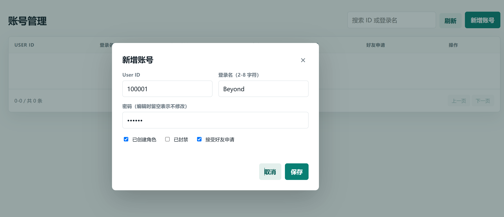
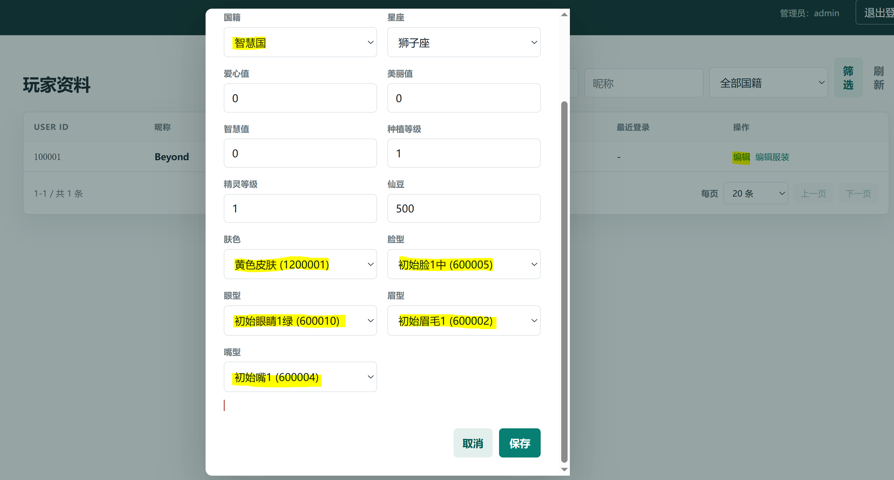
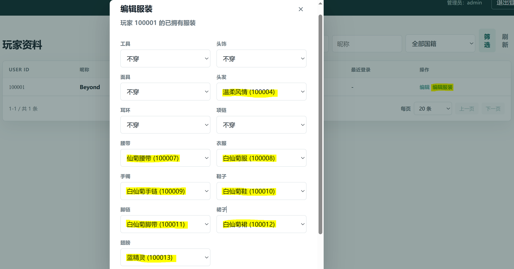
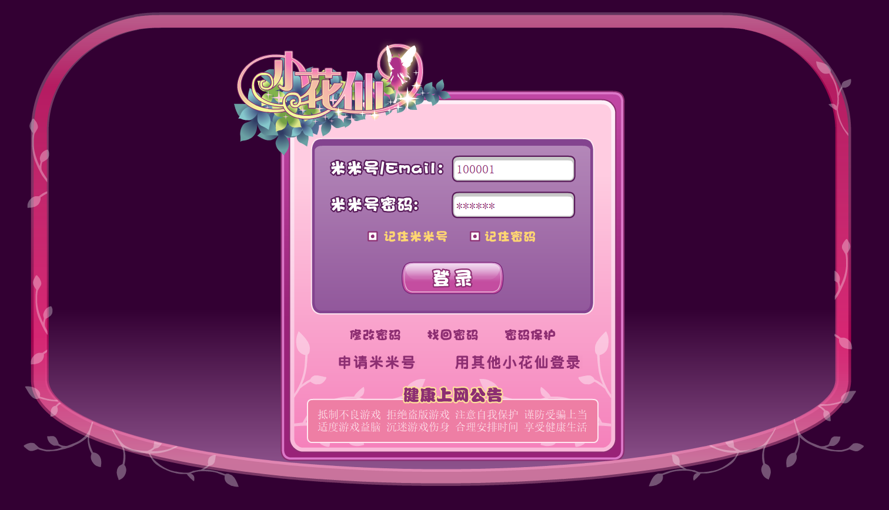
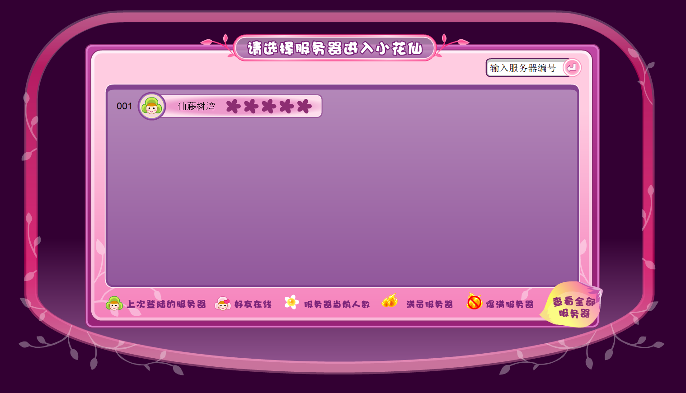
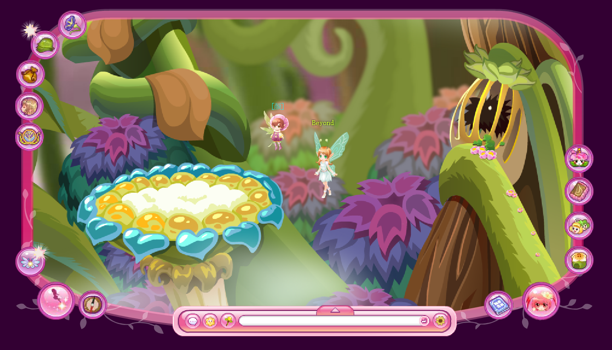
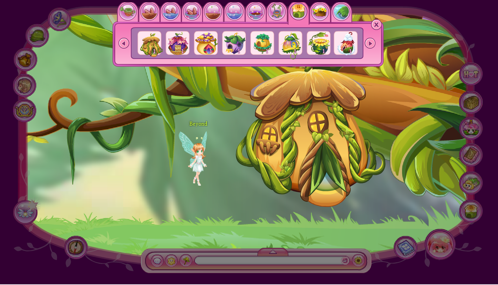
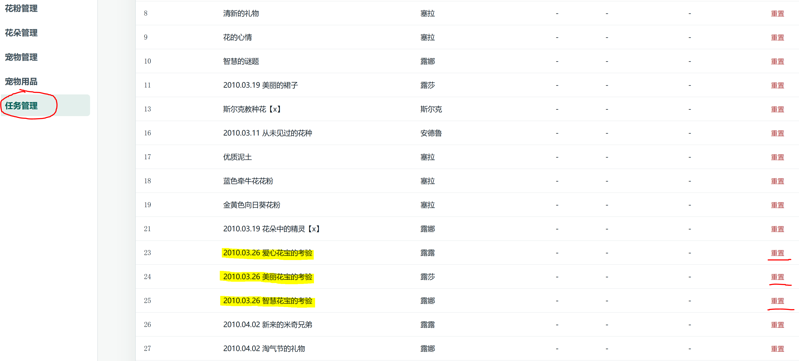
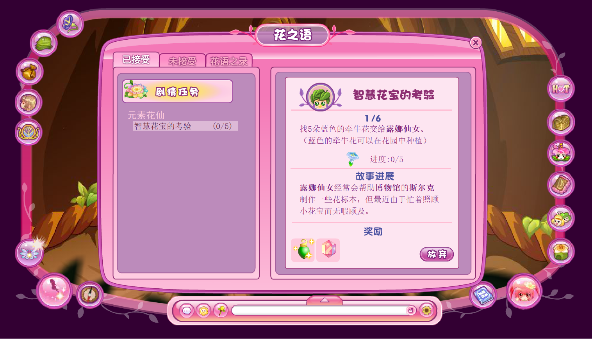

## 💡 引言

本项目是淘米网页游戏“小花仙”的伪服务端（版本号 1373622248，2013年7月）。配合 2013 年的资源文件，不仅可以重新体验旧版 UI 界面与流畅的操作，还可以建立私人服务器，与朋友一起参与游戏，同时管理所有玩家的配置参数和各类资产。 

作者对游戏核心 swf 文件进行反编译，得到 Action Script 3 脚本，同时借助 Codex，反推出服务端的响应逻辑，进而生成了伪服务端代码，可以代替官方的服务端代码与用户进行通信，基本实现游戏业务逻辑。

与 https://github.com/chenbk85/taomee 项目中官方服务端源码泄漏不同，此游戏的服务端 C++ 源码从未被泄漏过，因此本项目的全部代码均是通 【客户端反编译 + 协议反推】 得到的，耗时、耗资巨大，且不涵盖官方的全部功能。

如果您的目标是体验与 2013 版完全一致的内容，那么本项目必然无法满足您的需求。

本项目并非下载得到一个 .exe 文件，双击即可运行那么简单。 对从未接触过 浏览器-服务器（B/S）架构项目部署的小白来说，本项目的上手门槛极高，很可能耗费您大量的时间和精力去学习和试错。如果您愿意尝试，那么请做好心理准备。

## 🛠 架构栈 【重要必读！】

本项目涉及的架构栈如下：
- **前端**：包含 html 网页、css 样式、js 脚本 和 Flash (*.swf) 素材文件，作用是与用户直接产生视觉、听觉交互，接收用户输入、发送请求，最后反馈响应结果。只有前端文件是不够的，因为通过双击打开的 html 网页，这个网页是无法正常加载 Flash 的（URL地址栏以 file:// 打头），此时需要 Web 服务器才能正确运行。
- **Web 服务器**：作为前端容器，为大量 Flash 文件的加载提供环境。在容器根目录运行 python -m http.server 命令即可启动一个简易 web 服务器，或双击 start-web.bat 脚本也可便捷执行上述命令。Web 服务器启动后，访问 127.0.0.1:8000 即可连接。用户可通过浏览器的 http 协议连接 Web 服务器，异步加载所有站内资源。
- **伪服务端**：即本项目的全部内容，包含各类业务处理逻辑，如登录、移动交互、发言交互、好友、地图切换等。由于官方的 C++ 真服务端源码未泄露，因此本项目只是一个伪服务端，仅实现了最基础的业务逻辑，无法涵盖官方的全部功能。
- **MySQL 数据库**：实现持久化存储与高效查询。由于同时为多名用户提供服务，所以不能简单的把这些用户的数据写在一两个文件中，这样效率低下而且不安全。必须用引入专业的数据库系统进行数据管理。MySQL 具备专业算法，当几百用户同时查询、更新数据时，响应速度依然很快。

上述部分必须【全部】运行起来，才能使整个项目正常运行。

本项目仅包含【伪服务端】，对缺失部分的要求如下：
前端：由于请从 Release 下载缺失的 Flash 资源文件，解压到 www 路径下。请确保目标磁盘分区有不少于 2 GB 的剩余空间。

---
## 🚀 运行 【重要必读！】

### 配置数据库
1. 下载数据库：请从 MySQL 官网 【 https://dev.mysql.com/downloads/installer/ 】 下载 MySQL 8.0 驱动。请根据实际环境，选择正确的 操作系统 和 CPU架构（AMD / ARM），然后安装到系统上。用户名和密码均为 **root** 
2. 导入数据：MySQL 安装完毕后，请从终端连接并新建一个数据库 [ 名称：hua_2013，字符集编码：utf8mb4 ]，然后运行该 hua_2013.sql 脚本。

### 配置服务端

请先确保 Python 环境已经安装，然后切换到项目根目录，

1. 创建 Python 虚拟环境
```
python -m venv .vnev
```
2. 进入虚拟环境
```
.venv\Scripts\activate
```
3. 安装依赖
```
pip install -r requirements.txt
```
4. 运行服务端
```
python main.py
```
或者直接运行 `run-server.bat`。游戏登录服务器默认运行在`8430`端口，游戏业务服务器默认运行在`8431`端口。`python main.py --help` 可查阅启动参数

### 运行 Web 服务

1. 下载前端文件： 请在发布页面下载前端文件，并解压缩到独立的文件夹下。然后切换到该目录，命令行运行 `python -m http.server -p 8000` 启动 Web 服务器，或者直接运行 `run-web.bat`

2. 安装浏览器： 推荐使用 Basilisk 开源浏览器，并安装移除了 Timebomb（时间炸弹）的 Adobe Flash 插件。如安装困难，部分国产浏览器可以作为替代方案。

3. 浏览器访问： http://127.0.0.1:8000/  注意启用 Flash 插件，即可自动加载播放 swf 文件。

### 运行后台管理系统

1. 切换到 `./admin` 目录下，运行 `python server.py`，或者运行根目录的 `run-admin.bat` 即可启动后台，默认端口`8080`，用户名`admin`，密码`admin123`。修改密码需要修改代码。 

---
## 🥧 功能（了解）

### 已有功能（Flash）：

|  类别  | 描述                                        |
|:----:|:------------------------------------------|
|  登录  | 账号密码登录，记住密码快捷登录                           |
| UI设置 | 关闭音乐、炫动飞行、隐藏人物                            |
| UI聊天 | 同步地图其他玩家的形象、位置。发送地图聊天、快捷文字、表情。使用动作、魔法变身道具 |
|  好友  | 允许/拒绝添加好友、申请添加好友，切换密友，小窗聊天（消息喇叭），黑名单      |
| 场景切换 | 通过导航切换地图，通过地图上的指示牌切换地图 **（注：❌世界地图不可用）**   |
| 装饰切换 | 通过花瓣书更换服装，保存 / 应用 / 删除预设套装。               |
| 场景布置 | 切换小屋背景，摆放家具 **（注：❌花园装饰不可用）**              |
|  种植  | 播种、浇水、施肥、授粉、采集、治疗、铲除操作 **（注：❌爱心地不可用）**    |
|  宠物  | 喂食、清洁、玩具、治病、跟随/放回操作 **（注：❌无来信、无孤儿院状态）**   |
| NPC  | 聊天、写信、购物、各类任务阶段推进 **（注：❌兑换稀有种子、出售花束不可用）** |
| 小游戏  | 乐器制作、服装制作、料理制作、花宝逗逗乐、教小鸟飞行、音乐浪潮、浇灌绿洲      |
| 任务系统 | 各类新手任务、每日任务、剧情任务（注：🟡仅限 2010 年）           |

### 已有功能（后台系统）：

|   类别   | 描述                                          |
|:------:|:--------------------------------------------|
|  用户登录  | 修改任意玩家的账号、密码、封禁状态                           |
|  角色信息  | 修改任意玩家的角色名、国籍、星座、注册时间、等级、VIP等级等             |
|  骨骼信息  | 修改任意玩家的肤色、脸型、眼型、眉型、嘴型信息                     |
|  服装信息  | 修改任意玩家拥有的服装部件                               |
|  动作列表  | 修改任意玩家的魔法动作剩余次数                             |
|  物品信息  | 修改任意玩家的所有物品（花、种子、材料）                        |
|  家园信息  | 修改任意玩家的家园背景、种植工具、作物品种、位置、成长状态（时间、水分、养分、产出等） |
|  种植信息  | ❌暂无                                         |
|  小屋信息  | 修改任意玩家的小屋背景、拥有家具、摆放位置                       |
|  宠物信息  | 修改任意玩家的宠物状态（状态、经验等级、健康、饥饿、清洁、心情、VIP等级等）     |
|  任务信息  | 查看任意玩家的任务状态，重置任务。                           |
| 修改地图音乐 | ❌请直接替换 ./resource/sound/bg/ 目录下的文件          |

### 缺失功能

1. 无法走正常注册流程，只能通过后台系统添加新号
2. 世界地图无法打开（旧版地图的 swf 相关素材无法从互联网上找到），地图路标仍使用新版
3. 活动系统无法使用
4. 花精灵 / 精灵树系统无法使用
5. 美仙秀功能无法使用
6. 聚会小屋功能无法使用
7. 奇妙花宝技能不能使用、孤儿院不可用
8. 灵豆商店功能无法使用
9. 万事屋的功能无法使用
10. 部分小游戏无法运行（尤里的化妆箱、精灵合唱团、连连看、雪之铃、花宝快飞）
11. 部分任务无法推进（11~13年的任务，后续会逐步修复）

### 演示示例

1. 请通过管理系统新建账号

2. 设置国籍和形象

3. 设置初始服装

4. 登录账号

5. 选择服务器

6. 游戏截图

7. 设置家园小屋

8. 可通过任务，领取宠物花宝

9. 任务页面


---
## 🎯 部署（了解）

如果你是单机或者自己注册多个小号，那么可跳过本节；如果你和其他人联机，那么请仔细阅读。

### 定义
对于 B/S 架构的项目，部署是指将服务端程序和客户端资源【都】放置到网络主机上，由个人电脑通过【浏览器】下载客户端资源，最终实现与服务器双向通信的目标。

### 分类

根据访问规模不同，分为内网部署和公网部署。
- 内网部署：使用交换机或路由器组建局域网，为主机分配内网IP，同时上传资源，最终实现同一局域网内的多台主机间参与游戏的结果。可细分为本地局域网、虚拟局域网。
- 公网部署：购买服务商提供的互联网服务器，获得全球唯一且固定的公网IP地址，同时上传资源，最终实现全球范围内所有主机均可参与游戏的结果。

### 区别
内网部署仅适用于家庭、宿舍等范围极度受限的场景。公网部署适用于全国范围的非商业、商业访问场景。强烈建议您不要将本项目直接部署到公网上，后者属严重的侵权行为，极易遭到游戏版权方的法律诉讼。

### 建议
- 如果您希望在家庭、宿舍等小范围内和别人共同加入游戏，那么请准备一台交换机或路由器，然后将所有玩家的电脑接入网络，同时将所有文件放置到其中一台主机上运行起来作为服务器，并将 ./config/Server.xml 文件里的 3 个 127.0.0.1 地址改为局域网服务器主机的 IP。
- 如果您希望和距离较远的亲人、朋友共同加入游戏，又不想公网部署，那么我推荐以下 2 种方案：
	- 若参与方的家用宽带均为 NAT3（端口受限锥形） 及以上，可购买中转服务器（STUN），搭建虚拟局域网实现内网穿透，以极低的成本实现高速直联。
	- 若参与方的家用宽带存在 NAT4（对称型），双向内网穿透必然失败，可选择增值中转方案（如蒲公英），搭建虚拟局域网。大概率需要购买增值服务，以获取更高的转发带宽、更多的接入主机数量。
- 请严格遵循虚拟局域网搭建流程，逐步操作，搭建隧道。如果为图省事直接将本项目部署到公网上，那么请自行承担相应后果。

有关虚拟局域网的搭建流程，本教程不再赘述。如需了解更多知识，请查阅相关资料、询问 AI 或身边的专家。

---
## ❓ 问答（了解）

### 概述问题

<details open>
<summary><b>Q1: 游戏是原版吗？</b></summary>
客户端是原版，但服务端不是。部分素材（如地图场景）也是使用的 2026 年的，原因是互联网上搜不到全部的原版素材。
</details>

<br />

<details open>
<summary><b>Q2: 所有功能都正常吗？</b></summary>
只有基本功能正常。世界地图、花精灵、派对、地图活动等均不可用。已有功能存在较多 BUG，后续会逐步修复。
</details>

<br />

<details open>
<summary><b>Q3: 这个项目免费吗？</b></summary>
完全免费。这是一个开源项目，不仅免费，还能二次开发。如果有人是购买得到的本项目，那么一定被骗了。
</details>

<br />

<details open>
<summary><b>Q4: 为什么没有最新的服装、道具？</b></summary>
本项目用到的游戏版本，发布时间为 2013 年 7 月，之后的服装和道具尚未产生。
</details>

<br />

<details open>
<summary><b>Q5: 我可以控制整个游戏的全部数据吗？</b></summary>
完全可以。项目运行后，你的身份就等同于官方，拥有最高的管理权限。
</details>

---
## 🎨 最后

### 再次提醒

- 对从未接触过软件开发的人来说，本项目有极高的部署门槛，全流程会花费大量时间和精力。如该 README 文档无法解答你的全部疑问，请询问专业人员或 AI。

- 本项目仅供个人研究，严禁用作商业用途，严禁销售！再次强调个人用户为避免侵权，请勿将本项目部署到公网。

- 本项目中的所有伪服务端源码遵循 GPL 开源协议。 本 Repo 之外涉及到的前端文件和资源文件的版权归淘米公司所有。

### 求助

作者在此向官方工作人员征集此游戏的早期 swf 资源，尤其是世界地图 WorldMap_BG.swf 文件。如果您是公司内部人员并愿意分享素材，请从 Pull Request 告知下载链接。请做好个人信息防护。作者本人不便泄漏联系方式，请谅解！